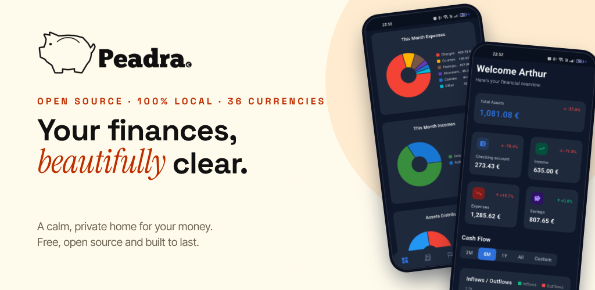

  

  
  
  

    

## Overview

Peadra ("*wealth*" in Breton) is a free, secure, privacy-focused cross-platform application designed to streamline personal finance and asset management.

Built with **Flutter & Dart**, it runs natively on **Linux, Windows and Android**.  
Your financial data stays **100% local**.  
Track your assets, from the daily expense to the stock market shares, and keep full control of your finances.

## Features

**Privacy & Bank-Grade Security**
* **Your data stays yours:** Local SQLite database encrypted with AES-256-GCM.
* **Multi-User Security:** SHA-256 password hashing for safe local multi-user access.

**Portfolio & Visual Insights**
* Track your net worth, asset distribution, and financial progress over time.
* Start budgeting by setting savings and spending goals.
* Interactive bar charts, pie charts, and line graphs to decode your spending habits.
* Dynamic categories: easily rename, merge, and organize your categories.
* Keep track with your stock market shares.

**Multi-Account & Multi-Currency Management**
* Manage distinct accounts with custom color-coding and independent tracking.
* Supports **36 currencies** with automated exchange rate conversions.
* Fast entry: smart auto-suggestions based on your transaction history.
* Easily log expenses, incomes, and inter-account transfers.

**Local Sync & Easy Import/Export**
* **Cross-Device Local Sync:** Sync seamlessly across Android, Windows, and Linux devices *over your home Wi-Fi network*.
* Smart CSV import & export for effortless backups and data migration.

**Tailored to You**
* Available in **French**, **Spanish** and **English**.
* Choose among many built-in themes.

> ...and many more features [to come](TODO.md) !

## Install

To install the app, please download your designated installer in the [release](https://github.com/Arthurfert/Peadra/releases) section :

|  Device | Installer |
| :----------------: | :-----------------: |
| Android | peadra-*version*-android.apk or [Google Play](https://play.google.com/store/apps/details?id=com.peadra.peadra) |
| Windows | peadra-*version*-windows.msix + .cer |
| Linux (debian-based) | peadra-*version*-linux.deb |

> [!NOTE]
> For **Windows users**, you will need to download and install the `peadra.cer` file (certificates for windows to trust Peadra).

For developper's setup instructions, see [INSTALLATION.md](./INSTALLATION.md).

*Due to Apple paywall and severe gatekeeping on apps on both Mac & IOS, Peadra is not available on those machines -unless you build it yourself.*

You can access the developer documentation [here](https://deepwiki.com/Arthurfert/Peadra).

## Technologies

- **UI Framework:** [Flutter](https://flutter.dev/) - Google's cross-platform UI toolkit for natively compiled apps
- **Language:** [Dart](https://dart.dev/)
- **Database:** [sqflite](https://pub.dev/packages/sqflite) - SQLite for Flutter
- **Encryption:** [cryptography](https://pub.dev/packages/cryptography) - AES-256-GCM + PBKDF2 for at-rest database encryption

## External sources

- **Exchange rates:** [ExchangeRate-API](https://www.exchangerate-api.com/) the open endpoint at [open.er-api.com](https://open.er-api.com/) provides the currency conversion rates used for multi-currency accounts.

## License

This project is licensed under the [GNU-GPL License](./LICENSE).

## Acknowledgments

- Built with [Flutter](https://flutter.dev/) — Google's UI toolkit for building natively compiled applications
